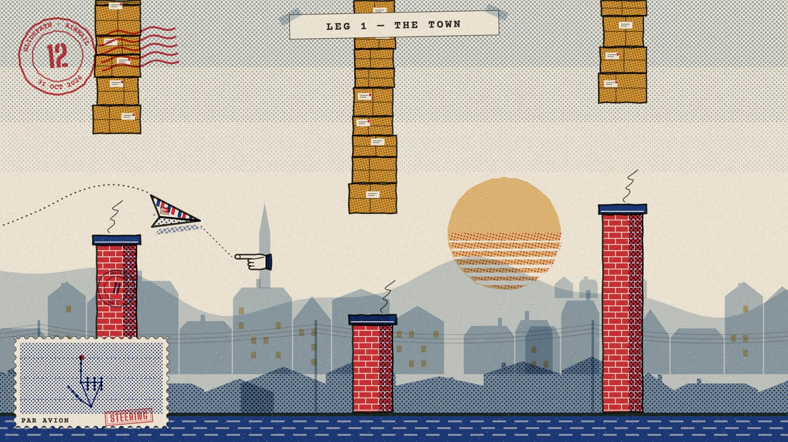
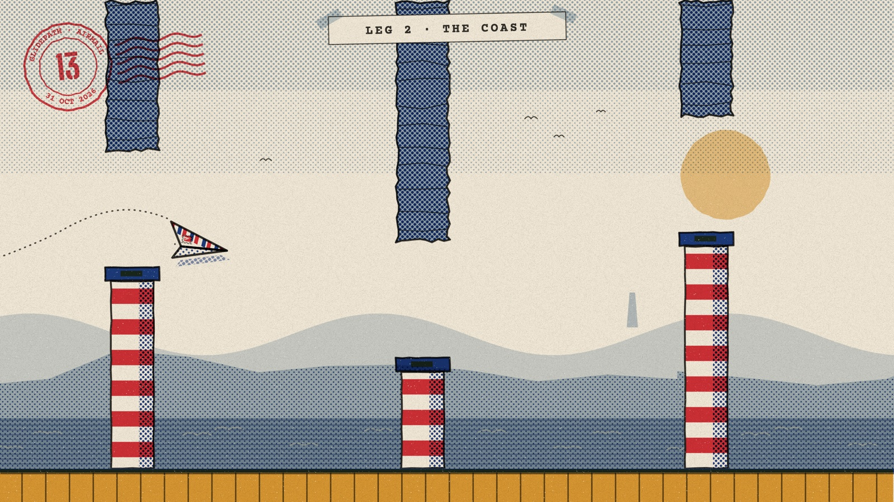
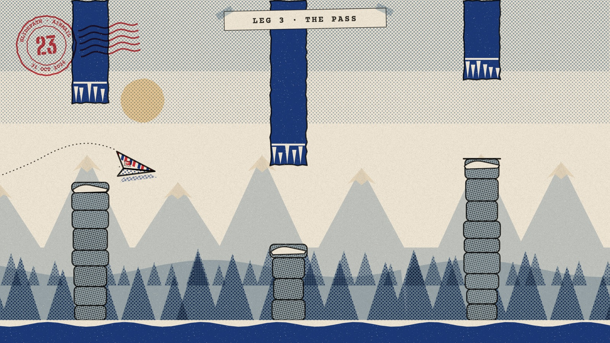
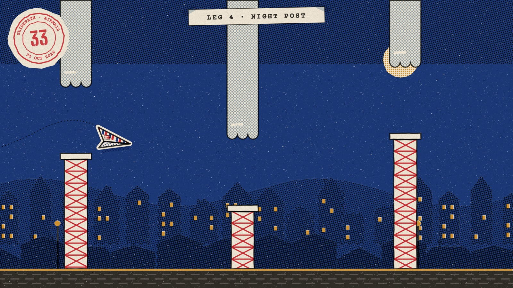
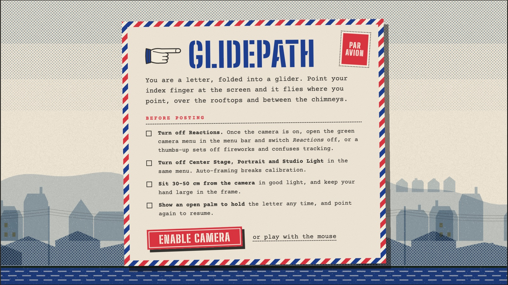
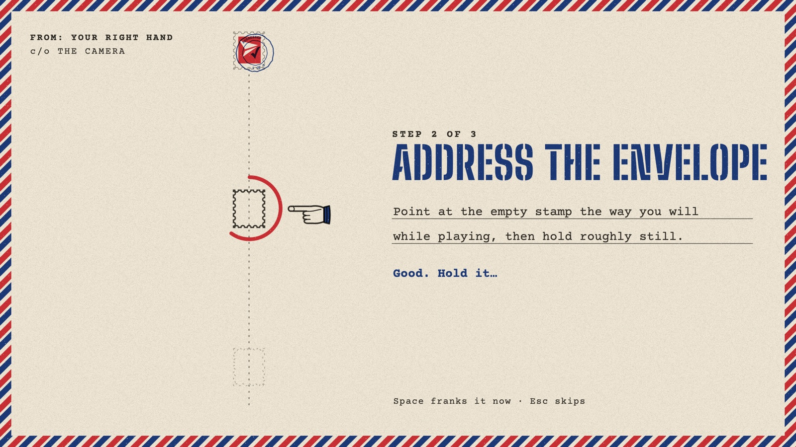

<h1 align="center">Glidepath</h1>

<p align="center"><em>Air mail, by hand.</em></p>

<p align="center">
  
</p>

You are a letter, folded into a paper glider. Point your index finger at your webcam and the glider
flies where you point: over the rooftops, past the lighthouses, up through a mountain pass and on
into the night post.

There's no controller and nothing to click. A hand tracker watches your finger at camera rate, and
the glider follows it like it's on a string. Every frame is drawn to look like a risograph print,
and the soundtrack is composed while you play.

## Play it

You need a Mac with a webcam, Chrome, and Node 20.19+ (or 22+).

```sh
npm install      # also fetches the MediaPipe runtime and hand model into public/mediapipe
npm run dev
```

Open the address Vite prints, press **Enable camera**, and address the envelope. That's the
calibration: point at three empty stamps, the way you will while flying, and hold still for a
moment on each. It's saved, so you only do it once. No webcam? **Play with the mouse** works too.

| Gesture or key | What it does |
|---|---|
| Point at the screen | Steer. Only altitude matters, so aim up and down |
| Keep pointing on the ready slip | Launch |
| Open palm, held | Hold the letter (pause). Point again to resume |
| Thumb tap on the side of your index finger | Flap, in tap mode |
| <kbd>Space</kbd> | Launch · capture a calibration stamp |
| <kbd>C</kbd> / <kbd>Esc</kbd> | Recalibrate / skip calibration |
| <kbd>M</kbd> | Switch between follow mode and tap mode |
| <kbd>S</kbd> | Mute everything |

Before you start, open the green camera menu in the macOS menu bar and turn off **Reactions**,
**Center Stage**, **Portrait** and **Studio Light**. A thumbs-up can set off fireworks, and
auto-framing moves the picture under your calibration.

## The route

Every ten gates the page tears away and a new leg begins. Each leg has its own key, tempo and
obstacles. After Night Post the route comes round again, but the leg counter keeps going.

<p align="center">
  
  
  
</p>

| Leg | Above / below | Score |
|---|---|---|
| 1 · The Town | parcels on a string / brick chimneys | D major, 84 bpm |
| 2 · The Coast | rock overhangs / lighthouses | A major, 92 bpm |
| 3 · The Pass | icicled ledges / stone cairns | E minor, 76 bpm |
| 4 · Night Post | cloud banks / radio masts | B♭ lydian, 70 bpm |

When you crash, the glider crumples into a ball and you get a postcard of the run: your whole flight
traced in pencil, a postmark with the score, and RETURN TO SENDER stamped across it.

<p align="center">
  
  
</p>

## How it works

**Tracking never blocks drawing.** Each camera frame arrives through
`requestVideoFrameCallback` and becomes an `ImageBitmap`. That bitmap is transferred to a module
worker running MediaPipe's HandLandmarker (GPU delegate, CPU fallback), and only one frame is in
flight at a time. The render loop runs at the display's rate, 120 Hz on a ProMotion screen, and
never waits on vision.

**Pointing, not posing.** Steering follows the index finger's joints plus a small tilt term,
smoothed by a One-Euro filter that is steady when you hold still and quick when you move.
Calibration only maps altitude, piecewise-linear through three points, because altitude is all the
game uses.

**Why an open palm pauses and a fist doesn't.** When you aim at the lens, the model often decides
your index finger is curled, so a fist and a point look the same. An open palm, with three fingers
extended in both 3D and 2D, can't be mistaken for anything else. Nothing about steering depends on
classifying the hand as "pointing".

**A spring, not a teleport.** The glider chases your finger through a critically damped spring
with a capped timestep, so it feels the same at 60 Hz and 120 Hz.

**Printed, not rendered.** The game draws on a plain Canvas 2D, but treats it like a printing press:
- Six spot inks, overprinted with `multiply`, each slightly out of register by a fixed amount.
- Halftone dot screens at press angles instead of gradients.
- Paper grain and ink dropout over every frame.

Each gate's art is drawn once into its own bitmap, so ornate gates cost one `drawImage` a frame. A
test checks that the art never pokes outside its collision box. Scenery is always quieter than the
gates, and the glider is always the loudest thing on screen.

**The score writes itself.** Everything you hear is synthesised with Web Audio; there are no sample
files:
- A warm pad holds the chords.
- A music-box melody walks over each leg's pentatonic scale and always lands on a chord tone on
  the strong beats.
- Bass and brushed percussion join while you fly.

Each gate chime comes from the chord that's playing, so the sound effects harmonise with the music.
Holding the letter muffles the music, as if it's behind the sorting-office door.

## Project layout

```
src/
  math/     calibration, One-Euro filter, posture checks, pointing   (pure, tested)
  vision/   camera pipeline, MediaPipe worker, gesture interpreter
  game/     engine state machine, spring physics, rules               (pure, tested)
  ui/       renderer, overlays, HUD, settings
  ui/art/   the print: inks, paper, stamps, glider, gates, the four legs
  audio/    music theory (tested), synth voices, generative score, effects
```

```sh
npm run test:run    # math, physics, engine, art geometry, music theory
npm run typecheck
npm run build
```

`styleframe.html` previews the art without a camera: `#leg=0` to `#leg=3` for each leg, and
`#envelope` for calibration.

## Credits

Hand tracking by [MediaPipe Tasks Vision](https://ai.google.dev/edge/mediapipe/solutions/vision/hand_landmarker)
(Apache 2.0). Type is [Big Shoulders Stencil](https://fonts.google.com/specimen/Big+Shoulders+Stencil+Display)
and [Courier Prime](https://fonts.google.com/specimen/Courier+Prime) (SIL Open Font License),
self-hosted through Fontsource.
