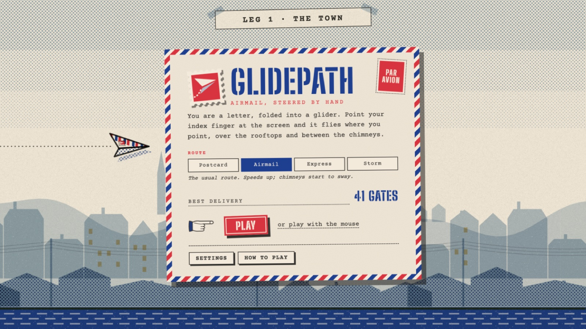
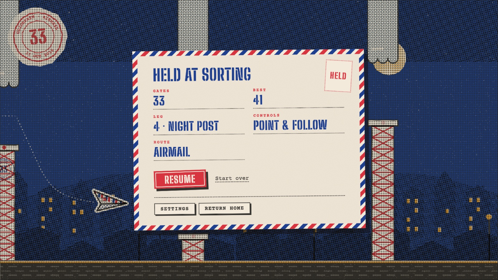
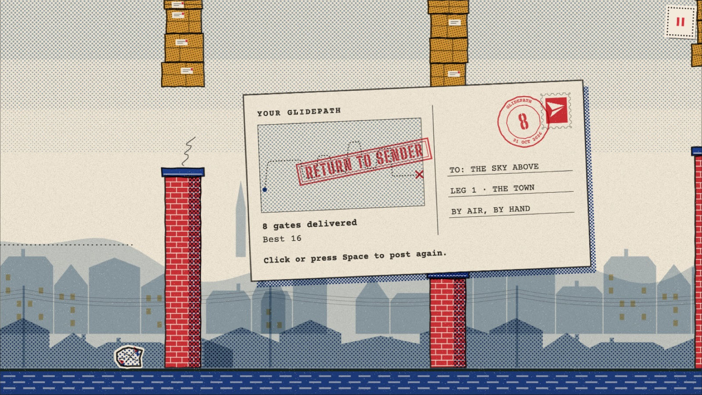

<h1 align="center">Glidepath</h1>

<p align="center"><em>Air mail, by hand.</em></p>

<p align="center">
  
</p>

You are a letter, folded into a paper glider. Point your index finger at your webcam and the glider
flies where you point: over the rooftops, past the lighthouses, up through a mountain pass and on
into the night post.

There's no controller and nothing to click. A hand tracker watches your finger at camera rate, and
the glider follows it like it's on a string. Every frame is drawn to look like a risograph print,
and the soundtrack is composed while you play.

Pick a route before you fly, from a gentle Postcard to Storm. Each run gets harder as you go:
faster, tighter, and with gaps that make you swing from rooftop to street and back.

## Play it

You need a Mac with a webcam, Chrome, and Node 20.19+ (or 22+).

```sh
npm install      # also fetches the MediaPipe runtime and hand model into public/mediapipe
npm run dev
```

Open the address Vite prints, choose a route on the home screen and press **Play**, then address
the envelope. That's the calibration: point at three empty stamps, the way you will while flying,
and hold still for a moment on each. It's saved, so you only do it once (redo it any time from
**Settings**). No webcam? **Play with the mouse** works too.

<p align="center">
  
  
</p>

**Settings** (from the home screen or the pause menu) holds the control mode, steering feel,
calibration, sound and display options. The stamp in the top-right corner, or <kbd>Esc</kbd>,
pauses a run and shows your gates, best, leg, controls and route, with Resume, Start over, Settings
and Return home. Your route and your best delivery on each route are kept between sessions.

| Gesture or key | What it does |
|---|---|
| Point at the screen | Steer. Only altitude matters, so aim up and down |
| Keep pointing on the ready slip | Launch |
| Open palm, held | Hold the letter (pause). Point again to resume |
| Pinch: thumb to the side of your index finger | Flap, in pinch mode (runs start hovering until your first flap) |
| <kbd>Space</kbd> | Launch · capture a calibration stamp |
| <kbd>Esc</kbd> / <kbd>P</kbd> | Pause menu (Esc skips calibration while calibrating) |
| <kbd>C</kbd> | Recalibrate |
| <kbd>M</kbd> | Switch between follow mode and pinch mode |
| <kbd>S</kbd> | Mute everything |

Before you start, open the green camera menu in the macOS menu bar and turn off **Reactions**,
**Center Stage**, **Portrait** and **Studio Light**. A thumbs-up can set off fireworks, and
auto-framing moves the picture under your calibration.

## Difficulty

The home screen offers four routes. Every route starts easy and ramps up gate by gate over its
first few dozen gates, then holds at its hardest:

- **Faster:** the street scrolls quicker.
- **Tighter:** the gap between top and bottom shrinks.
- **Closer:** the gates come at shorter intervals.
- **Bigger swings:** each gap must sit a minimum distance above or below the last one, so you
  can't park at one height and coast.
- **Swaying gaps:** past a certain gate, some gaps slide slowly up and down. You have to fly to
  where the gap *will be*, not where it is.

| Route | Speed (px/s) | Gap (px) | Ramp | Swaying gaps |
|---|---|---|---|---|
| **Postcard** | 230 → 340 | 200 → 165 | 60 gates | a few, from gate 30 |
| **Airmail** | 280 → 450 | 165 → 135 | 50 gates | from gate 12 |
| **Express** | 330 → 520 | 160 → 132 | 40 gates | from gate 4, wider |
| **Storm** | 390 → 600 | 152 → 126 | 35 gates | from the first gate, most of them |

Each route keeps its own best score, so an easy run never overwrites a Storm record.

## The journey

Every ten gates the page tears away and a new leg begins. Each leg has its own key, tempo and
obstacles. After Night Post the journey comes round again, but the leg counter keeps going.

<p align="center">
  
  
  
</p>

| Leg | Above / below | Score |
|---|---|---|
| 1 · The Town | parcels on a string / brick chimneys | D major, 84 bpm |
| 2 · The Coast | rock overhangs / lighthouses | A major, 92 bpm |
| 3 · The Pass | icicled ledges / stone cairns | E minor, 76 bpm |
| 4 · Night Post | cloud banks / radio masts | B♭ lydian, 70 bpm |

When you crash, the glider crumples into a ball and you get a postcard of the run: your whole flight
traced in pencil, a postmark with the score, and RETURN TO SENDER stamped across it.

<p align="center">
  
  
</p>

## How it works

**Tracking never blocks drawing.** Each camera frame arrives through
`requestVideoFrameCallback` and becomes an `ImageBitmap`. That bitmap is transferred to a module
worker running MediaPipe's HandLandmarker (GPU delegate, CPU fallback), and only one frame is in
flight at a time. The render loop runs at the display's rate, 120 Hz on a ProMotion screen, and
never waits on vision.

**Pointing, not posing.** Steering follows the index finger's joints plus a small tilt term,
smoothed by a One-Euro filter that is steady when you hold still and quick when you move.
Calibration only maps altitude, piecewise-linear through three points, because altitude is all the
game uses.

**Why an open palm pauses and a fist doesn't.** When you aim at the lens, the model often decides
your index finger is curled, so a fist and a point look the same. An open palm, with three fingers
extended in both 3D and 2D, can't be mistaken for anything else. Nothing about steering depends on
classifying the hand as "pointing".

**A spring, not a teleport.** The glider chases your finger through a critically damped spring
with a capped timestep, so it feels the same at 60 Hz and 120 Hz.

**Difficulty is data.** Each route is a table of start and end values (speed, gap, spacing,
minimum and maximum swing, sway chance, size and rate) that the engine eases between as the score
climbs; the same pure function drives the game and the tests. Swaying is capped at a slow drift so
a gap can still be tracked through camera and spring lag. In simulation, a bot with a human-like
150 ms delay that anticipates the sway clears every route, while one that only reacts to where
the gap is now runs out on Express and Storm.

**Printed, not rendered.** The game draws on a plain Canvas 2D, but treats it like a printing press:
- Six spot inks, overprinted with `multiply`, each slightly out of register by a fixed amount.
- Halftone dot screens at press angles instead of gradients.
- Paper grain and ink dropout over every frame.

Each gate's art is drawn once into its own bitmap, so ornate gates cost one `drawImage` a frame.
A swaying gate is drawn once with room to spare and slid with its gap. A test checks that the art
never pokes outside its collision box. Scenery is always quieter than the
gates, and the glider is always the loudest thing on screen.

**The score writes itself.** Everything you hear is synthesised with Web Audio; there are no sample
files:
- A warm pad holds the chords.
- A music-box melody walks over each leg's pentatonic scale and always lands on a chord tone on
  the strong beats.
- Bass and brushed percussion join while you fly.

Each gate chime comes from the chord that's playing, so the sound effects harmonise with the music.
Holding the letter muffles the music, as if it's behind the sorting-office door.

## Project layout

```
src/
  math/     calibration, One-Euro filter, posture checks, pointing   (pure, tested)
  vision/   camera pipeline, MediaPipe worker, gesture interpreter
  game/     engine state machine, spring physics, rules, routes       (pure, tested)
  ui/       renderer, overlays, HUD, home / settings / pause screens
  ui/art/   the print: inks, paper, stamps, glider, gates, the four legs
  audio/    music theory (tested), synth voices, generative score, effects
```

```sh
npm run test:run    # math, physics, engine, routes, art geometry, music theory
npm run typecheck
npm run build
```

`styleframe.html` previews the art without a camera: `#leg=0` to `#leg=3` for each leg, and
`#envelope` for calibration.

## Credits

Hand tracking by [MediaPipe Tasks Vision](https://ai.google.dev/edge/mediapipe/solutions/vision/hand_landmarker)
(Apache 2.0). Type is [Big Shoulders Stencil](https://fonts.google.com/specimen/Big+Shoulders+Stencil+Display)
and [Courier Prime](https://fonts.google.com/specimen/Courier+Prime) (SIL Open Font License),
self-hosted through Fontsource.
